# BekantX – Montageanleitung

Diese Anleitung beschreibt den Zusammenbau der BekantX-Steuerung: Platine, OLED-Anzeige, Tastenmatte und Gehäuse
(Revision r3), und die Montage unter der Tischplatte.

> **Stand und Grenzen (2026-11-22):** Die Anleitung folgt dem CAD-Modell des Gehäuses r3
> (`CAD/src/bekantx_enclosure.py`) und der Platine `Pcb_Controller/BekantX.kicad_pcb` (6 Lagen). Das Gehäuse r3 ist
> probegedruckt (Fotos unten) und Gehäuse und Deckel passen zusammen; die Passung der Platine ist nur rechnerisch
> geprüft (keine Überschneidung, Einbauweg frei). **Ein vollständiger Zusammenbau mit einer bestückten Platine wurde
> noch nicht gemacht.** Die Fotos zeigen deshalb nur das leere, geschlossene Gehäuse; alles mit Platine ist
> gerendert. Schritte, die auf ungeprüften Annahmen beruhen, sind mit ⚠️ markiert.

## Der Probedruck

| Front mit Tasten- und Anzeigefenster | Rückseite mit Deckel und Tischlaschen | USB-Seite |
|---|---|---|
| 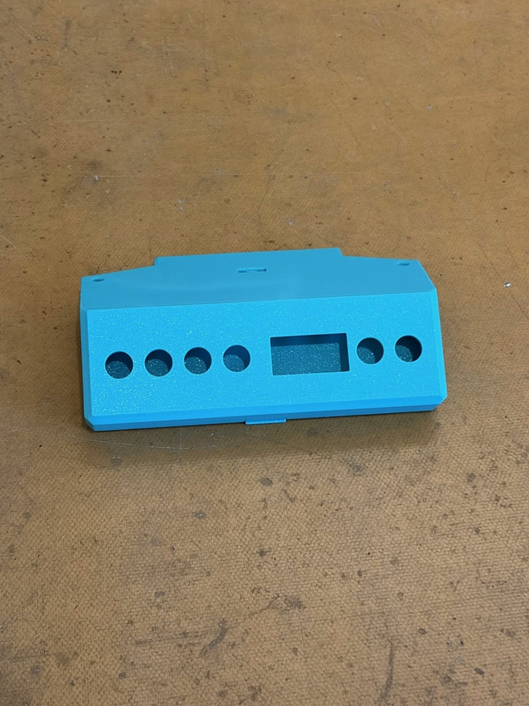 | 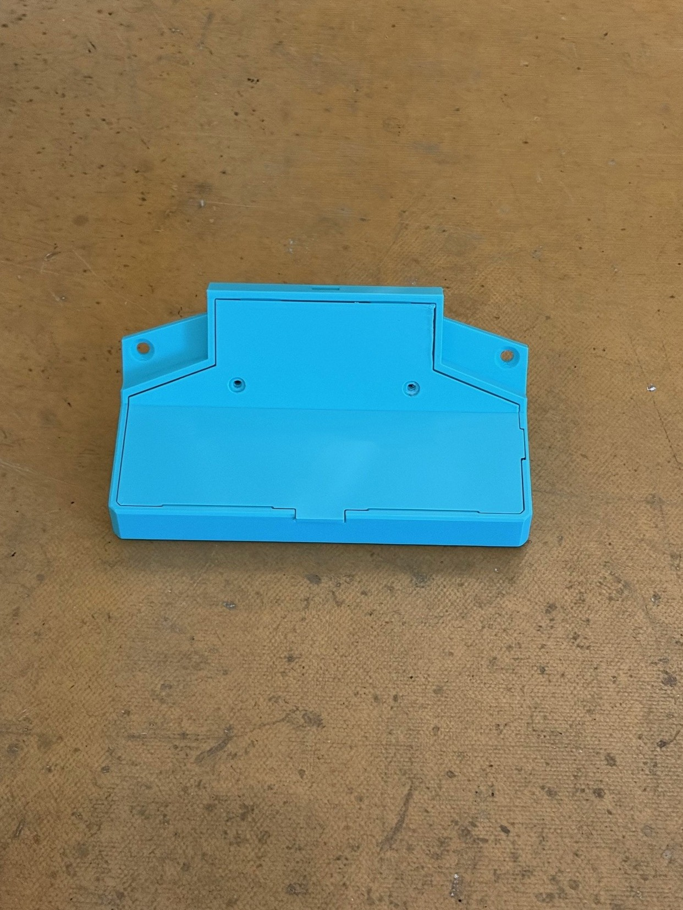 | 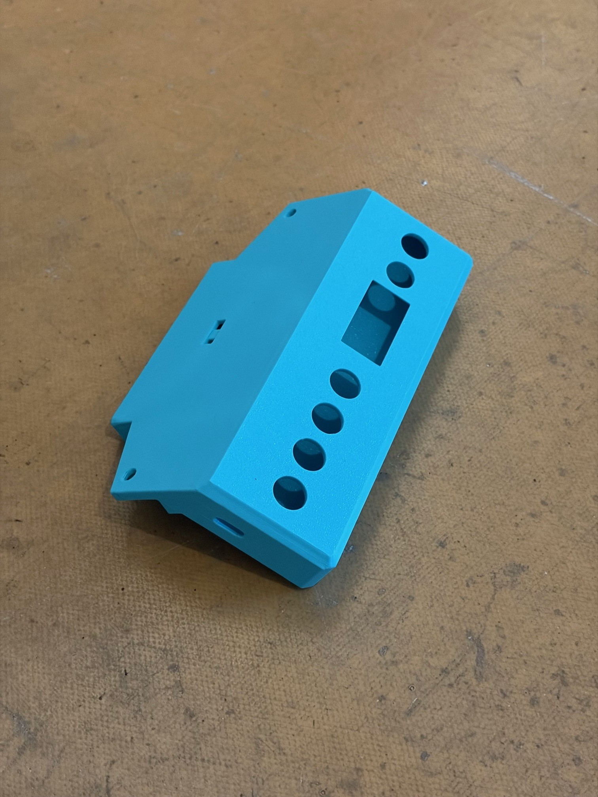 |

Die Fotos sind ohne Tastenmatte und ohne Platine aufgenommen: Die sechs Tastenlöcher und das Anzeigefenster sind
offen. Auf der Rückseite (Mitte) sind der Deckel mit seinen zwei Schrauben, die Lasche zum Öffnen an der Vorderkante
und die zwei Laschen für die Tischplatte zu sehen; rechts unten liegt die Öffnung für die USB-C-Buchse.

## Teile

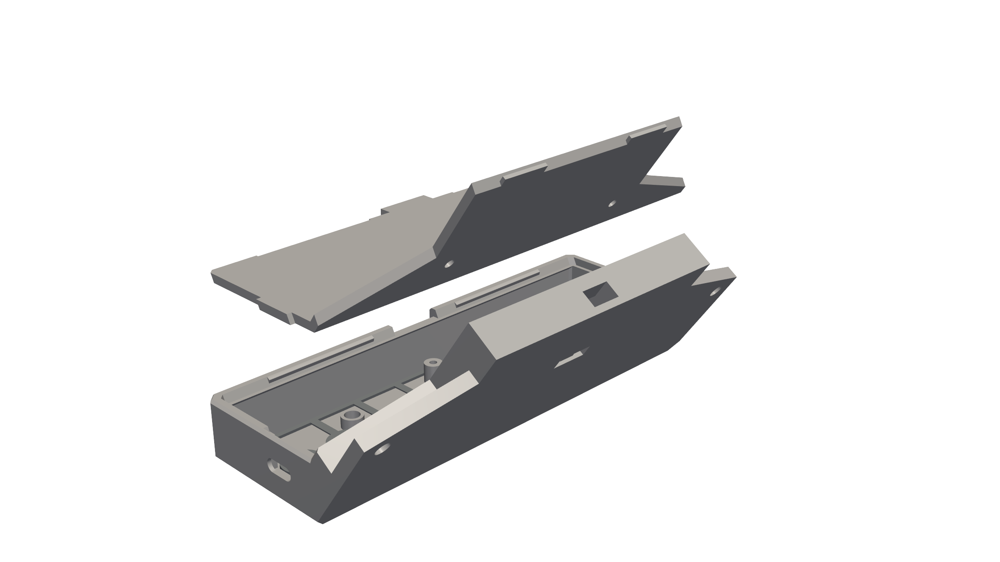

| Anzahl | Teil | Hinweis |
|---|---|---|
| 1 | Gehäuse (`CAD/BekantX_Case_r3.stl`) | Druckteil |
| 1 | Deckel (`CAD/BekantX_Lid_r3.stl`) | Druckteil |
| 1 | Tastenmatte (`CAD/BekantX_Keypad_r3.stl`) | Druckteil, sechs Tastenkappen an einem Steg |
| 1 | Platine, bestückt | `Pcb_Controller` |
| 1 | OLED 1.29" 128 × 64 (EastRising ER-OLED1.29-2) | mit 16-poligem FPC |
| 8 | Schraube M2.5 × 6, Linsenkopf (ISO 7045 oder ISO 14583) | 6 für die Platine, 2 für den Deckel, direkt in den Kunststoff |
| 2 | Holzschraube mit Senkkopf | für die Tischplatte; Loch 4.5 mm, Senkung 8.5 mm; Länge passend zur Tischplatte |
| 1 | dünnes doppelseitiges Klebeband | für das Glas der Anzeige |
| 1–2 | Kabelbinder, höchstens 3.2 mm breit | Zugentlastung des Tischkabels |
| 1 | Tischkabel mit 3-poligem Stecker im 2.54-mm-Raster | ⚠️ siehe Schritt 5 |

Werkzeug: Kreuzschlitz-Schraubendreher (PH1 für M2.5), Pinzette für das FPC.

## Drucken

- Drucker: Bambu Lab P1S. Prototyp in PLA, das Endteil in PETG.
- Schichthöhe 0.2 mm (die Arme der Tastenmatte sind genau zwei Lagen dick), **keine Stützen**.
- Ausrichtung: Gehäuse mit der Front auf dem Bett, Deckel mit der Innenseite des Blockteils auf dem Bett,
  Tastenmatte flach mit dem Steg auf dem Bett.
- ⚠️ Die Schrauben M2.5 × 6 schneiden ihr Gewinde selbst (Kernloch 2.25 mm). In PLA passt das; für PETG beim ersten
  Endteil prüfen.

## Die Platine im Überblick

| Vorderseite (zur Front des Gehäuses) | Rückseite (zum Deckel) |
|---|---|
| 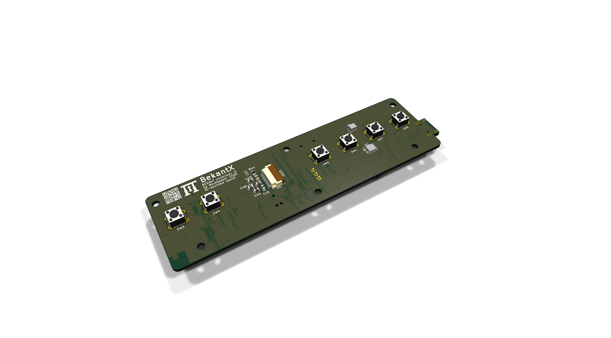 | 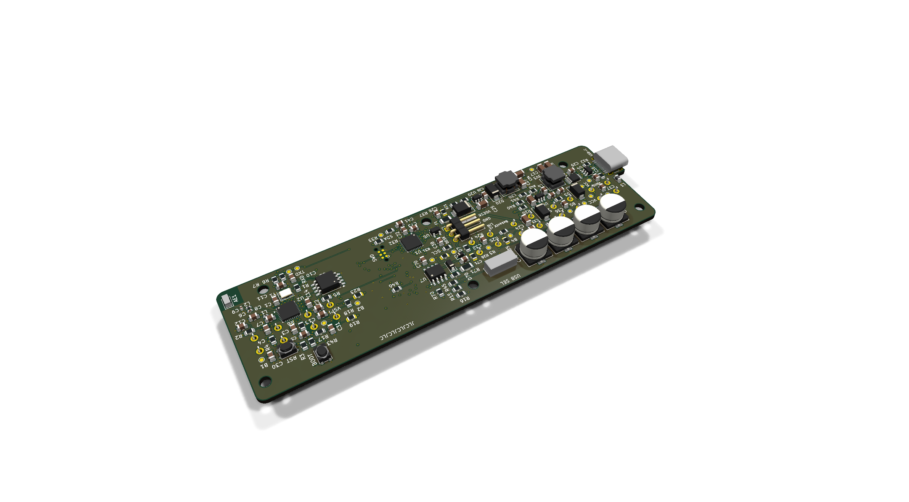 |
| Sechs Taster, Stecker **J3** für das Display-FPC, Status-LEDs | Alle übrigen Bauteile, USB-C-Buchse an der Nase, Tischstecker **J10**, Taster RST und BOOT, Schalter USB SEL, SWD-Anschluss |

Die Platine misst 129 × 38 × 1.6 mm und hat an der rechten Schmalseite eine Nase (3.8 × 11 mm), auf der die
USB-C-Buchse sitzt. Mit dieser Nase sitzt die Buchse bündig in der Seitenwand des Gehäuses.

## 1. Tastenmatte einsetzen

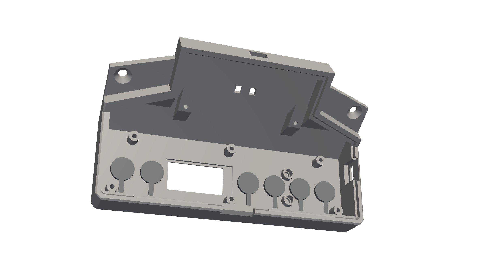

1. Das Gehäuse mit der offenen Rückseite nach oben hinlegen.
2. Die Tastenmatte von innen einlegen: Jede Kappe in ihr Loch in der Front, der Steg liegt an der Innenseite der
   Frontwand an.
3. Von vorne gelesen stehen links M1, M2, M3, M4, in der Mitte das Anzeigefenster, rechts Hoch und Runter.
   ⚠️ Diese Belegung ist eine Annahme und muss mit der Firmware übereinstimmen (`BTN_1` … `BTN_6`).

## 2. Anzeige an die Platine anschliessen

1. Das FPC der Anzeige in den Stecker J3 auf der Vorderseite der Platine schieben (Kontakte nach unten zur
   Platine) und den Riegel schliessen.
2. ⚠️ **Lage von Pin 1 prüfen, bevor Spannung anliegt.** Sie ist aus der Zeichnung im Datenblatt der Anzeige
   abgeleitet; das Datenblatt des Steckers lag nicht vor. Steckt das FPC verkehrt herum, liegen die Speisungen auf
   Signalpins. Den Footprint am besten 1:1 ausdrucken und mit dem echten Display probestecken.
3. Die Anzeige steht im Gehäuse für den Betrachter auf dem Kopf; das wird in der Firmware gedreht.

## 3. Platine einsetzen

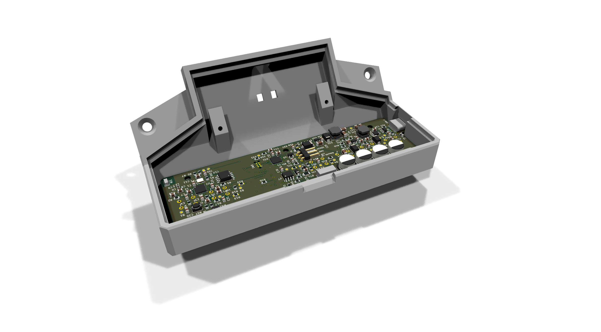

1. Ein Stück dünnes doppelseitiges Klebeband auf die Vorderseite des Display-Glases, ausserhalb der Sichtfläche.
2. Die Platine mit der Vorderseite (Taster, Anzeige) nach unten zur Front halten. Das Glas liegt dabei in der
   Tasche hinter dem Anzeigefenster.
3. **Einbauweg:** Die Platine um etwa 1.4 mm von der USB-Seite weg versetzt absenken. Die Nase mit der USB-Buchse
   geht dabei durch die Aussparung im Rand. Dann die Platine zur USB-Seite schieben, bis die Buchse in der
   Wandtasche sitzt und mit der Aussenseite der Wand abschliesst. Die Taster liegen jetzt unter den Kappen der
   Tastenmatte.
4. ⚠️ Das FPC faltet sich zwischen der Kante des Glases und dem Taster SW5 zum Stecker. Diese Faltung ist im
   CAD-Modell **nicht** nachgebildet: beim ersten Zusammenbau prüfen, dass nichts geknickt oder eingeklemmt wird.
5. Die Platine mit sechs Schrauben M2.5 × 6 auf den Domen festschrauben. Nur handfest anziehen, die Schrauben
   schneiden ihr Gewinde direkt in den Kunststoff.
6. Kurz prüfen: Alle sechs Kappen lassen sich drücken und federn zurück, die USB-C-Buchse ist von aussen
   erreichbar.

## 4. Firmware aufspielen (bei offenem Gehäuse)

Die Taster RST und BOOT, der Schalter USB SEL (wählt, welcher Controller an der USB-C-Buchse hängt) und der
SWD-Anschluss liegen auf der Rückseite der Platine. Sie sind nur bei abgenommenem Deckel erreichbar. Firmware
deshalb aufspielen, bevor der Deckel zugemacht wird.

## 5. Tischkabel anschliessen

1. **Den Tisch zuerst vom Netz trennen.**
2. Das Tischkabel durch den Kabelaustritt (9 × 5 mm) am Arm führen und auf den Stecker J10 stecken. Die Belegung
   steht auf der Platine: LIN, GND, VDESK.
3. Das Kabel mit einem Kabelbinder durch die Schlitze im Arm entlasten.
4. ⚠️ **Die elektrische Schnittstelle des Tisches ist noch nicht gemessen.** Belegung des Tischsteckers,
   Versorgungsspannung und LIN-Pegel sind Annahmen. Die Schutzschaltung am Eingang ist für Dauerspannungen bis
   33 V ausgelegt. Vor dem ersten Anschluss am echten Tisch die Belegung mit einem Messgerät prüfen. Auch Durchmesser
   und Stecker des Kabels sind nicht gemessen.

## 6. Deckel schliessen

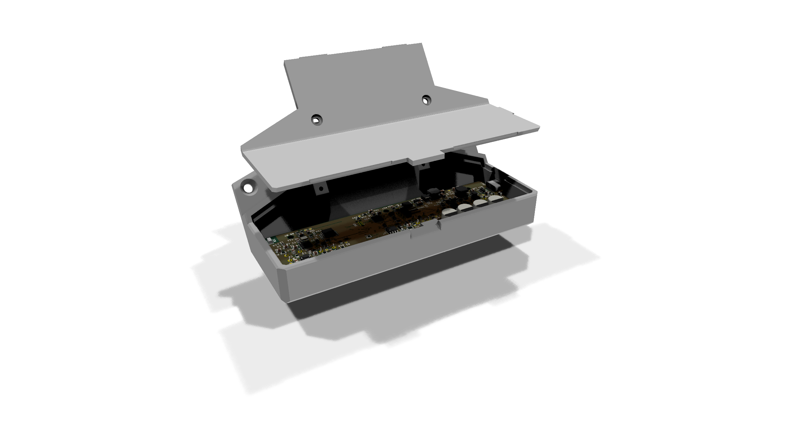

1. Die zwei Zungen am Armende des Deckels in die Taschen der Endwand einhängen.
2. Den Deckel um dieses Scharnier nach vorne schwenken, bis die Vorderkante unter den zwei Lippen der Frontwand
   einrastet.
3. Den Deckel mit zwei Schrauben M2.5 × 6 im Arm sichern (die Köpfe sitzen in Senkungen).
4. ⚠️ Der Schnapper hält über eine kleine elastische Verformung des Deckels (etwa 0.3 mm). Druckungenauigkeiten
   machen ihn lockerer oder strammer. Ist er zu stramm, hilft es, an der Deckelnase den «Elefantenfuss» des ersten
   Drucklayers zu entfernen.

So sieht der geschlossene Deckel am Probedruck aus:

**Öffnen:** die zwei Deckelschrauben lösen, mit dem Fingernagel unter die Lasche an der Vorderkante greifen
(die Frontwand ist darunter angefast) und den Deckel nach hinten aufschwenken.

## 7. Unter der Tischplatte montieren

| Rendering | Probedruck |
|---|---|
| 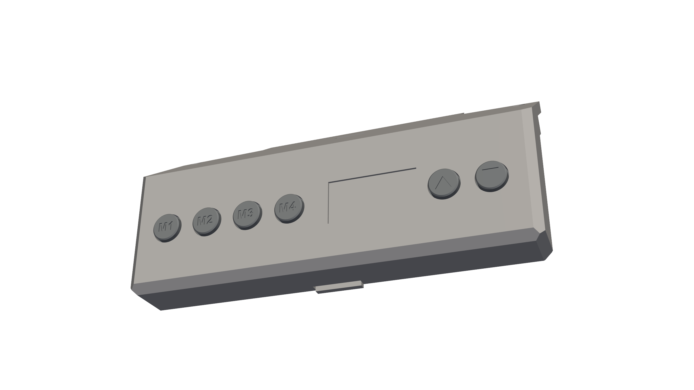 | 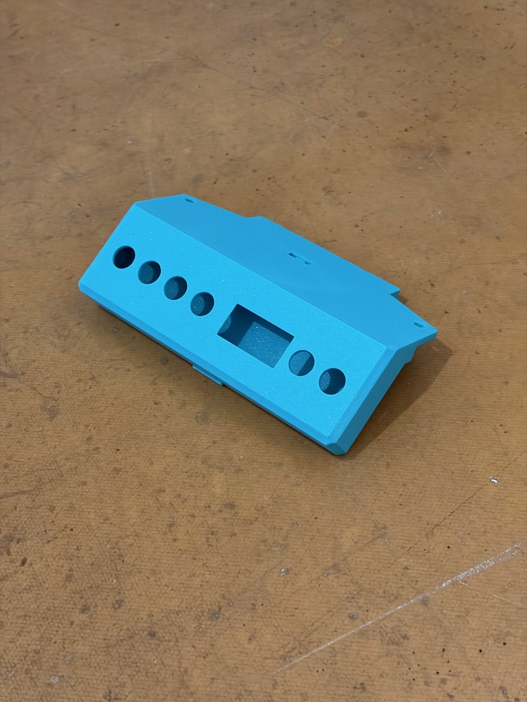 |

Der Arm ist um 55° abgewinkelt und liegt unter der Tischplatte an; der Frontblock mit Tasten und Anzeige zeigt
nach vorne. Das Gehäuse mit zwei Senkkopf-Holzschrauben durch die beiden Laschen am Arm an die Unterseite der
Tischplatte schrauben (Loch 4.5 mm, Senkung 8.5 mm). Die Schraubenlänge so wählen, dass sie nicht durch die
Tischplatte stösst.

## Was noch nicht geprüft ist

- Zusammenbau mit einer echten, bestückten Platine (noch nicht gefertigt).
- Elektrische Schnittstelle des Tisches (Stecker, Spannung, LIN-Pegel).
- Lage von Pin 1 am Display-FPC und die Faltung des FPC im Gehäuse.
- Tastenbelegung gegenüber der Firmware.
- Schnapper und Schraubengriff im PETG-Endteil.

Details und Stand: `Vault/Offene Punkte.md`. Renderings und wie sie entstehen: [`bilder/README.md`](bilder/README.md).
Die Fotos `Bild1.jpg` … `Bild4.jpg` und die beiden Titelbilder «BekantX Controller-Gehäuse» zeigen den Probedruck.
