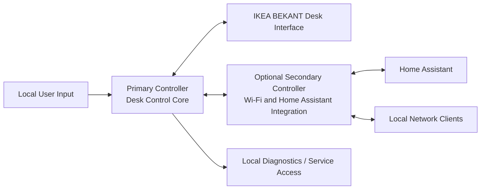

# BekantX System Architecture

## 1. Purpose

This document describes the initial system architecture of BekantX. It translates the requirements defined in the requirements specification into a concrete structural model with controller boundaries, interfaces, state ownership, and major data flows.

This is a logical architecture document. It defines responsibilities and interactions first. Exact hardware components and some low-level electrical details may still change during implementation, but the inter-controller transport is now defined as SPI.

## 2. Architectural Drivers

The architecture is driven by the following constraints and objectives:

- desk-critical control must remain independent from optional IoT features
- the desk must remain usable when the IoT controller is absent or faulty
- timing-sensitive desk communication must be isolated from Wi-Fi and Home Assistant activity
- automatic movement features such as memory recall require reliable state handling and safe interruption paths
- collision or obstruction handling must terminate motion in the primary control path
- future integration work should be possible without redesigning the desk-control core

## 3. High-Level Architecture

BekantX uses a dual-controller architecture with strict separation of responsibilities:

- the primary controller is the desk-control controller and owns all real-time and safety-relevant behavior
- the secondary controller is an optional IoT and integration controller and owns Wi-Fi connectivity and Home Assistant facing APIs

## 4. Controller Boundaries

### 4.1 Primary Controller

The primary controller is the authoritative runtime for desk operation. It owns all functions that must continue to work even when the optional IoT path is unavailable.

Primary controller responsibilities:

- desk bus or protocol communication
- startup sequencing and desk initialization
- desk state tracking
- move up, move down, stop, and controlled automatic movement
- calibration and range management
- memory position execution
- collision or obstruction detection
- fault detection and fault response
- arbitration between local and remote commands
- persistence of critical operational configuration
- validation of external commands before execution

The primary controller is the only controller allowed to command motion at the desk interface.

### 4.2 Secondary Controller

The secondary controller is optional and must not be required for basic desk operation. Its purpose is to provide connectivity and integration services without becoming part of the safety-critical control path.

Secondary controller responsibilities:

- Wi-Fi connectivity
- Home Assistant integration
- local network API exposure
- remote command submission to the primary controller
- remote status presentation
- telemetry forwarding and optional integration-side logging
- optional configuration UI or service endpoints if added later

The secondary controller does not directly own desk state. It consumes state from the primary controller and issues requests through the inter-controller interface.

## 5. Supporting Logical Subsystems

Within the overall architecture, the following logical subsystems are expected.

### 5.1 Motion Control Subsystem

Located on the primary controller. Responsible for movement commands, stop handling, automatic movement to target positions, and movement state transitions.

### 5.2 Safety and Fault Subsystem

Located on the primary controller. Responsible for collision detection, invalid state handling, communication watchdog behavior, and safe-stop decisions.

### 5.3 Position and Calibration Subsystem

Located on the primary controller. Responsible for maintaining known limits, position confidence, calibration state, and target height evaluation.

### 5.4 Persistence Subsystem

Located primarily on the primary controller. Responsible for storing critical configuration such as calibration data, thresholds, and memory positions. The secondary controller may cache non-authoritative integration settings if needed.

### 5.5 Integration Subsystem

Located on the secondary controller. Responsible for API endpoints, Home Assistant data mapping, authentication strategy, and translation between network-level requests and the primary controller command model.

## 6. State Ownership Model

To avoid ambiguity and split-brain behavior, system state ownership is assigned explicitly.

State owned by the primary controller:

- desk readiness
- motion state
- current position estimate or measured position
- target position during automatic motion
- upper and lower movement limits
- calibration validity
- memory position data if those values affect standalone operation
- collision or obstruction event state
- fault state and recent fault history
- command acceptance or rejection

State owned by the secondary controller:

- Wi-Fi connection state
- API session state
- Home Assistant discovery or mapping state
- network client connection state
- cached presentation data derived from the primary controller

Rule: if a state value influences actual desk movement, the primary controller is authoritative.

## 7. External Interfaces

### 7.1 Desk Interface

The desk interface connects the primary controller to the IKEA BEKANT electronics.

Expected properties:

- timing-sensitive
- electrically compatible with the target desk hardware
- implemented only by the primary controller
- hidden from the secondary controller

This interface is treated as a protected low-level boundary. Higher-level controllers and network clients do not access it directly.

### 7.2 Inter-Controller Interface

The inter-controller interface connects the optional secondary controller to the primary controller.

Logical capabilities required on this interface:

- status query
- health query
- move up request
- move down request
- stop request
- memory position recall request
- memory position set or overwrite request
- calibration-related requests if exposed
- diagnostics query
- event or fault reporting

Required characteristics:

- command framing
- version identification
- integrity protection such as checksum or CRC
- timeout behavior
- explicit error responses
- behavior defined for controller reset or reconnection

The physical transport is SPI.

Transport roles:

- the secondary controller acts as SPI master
- the primary controller acts as SPI slave

The protocol uses a request-and-poll mailbox model so that the primary controller can validate and queue responses without being forced to generate a complete application response during the same SPI transaction in which the request is received.

The detailed command set, frame format, timeout rules, and CRC definition are specified in [inter-controller-protocol.md](inter-controller-protocol.md).

### 7.3 Wi-Fi API

The Wi-Fi API is hosted by the optional secondary controller.

The API should expose at least:

- desk availability and controller health
- motion state
- current position when available
- active fault or obstruction state
- memory position information
- move and stop commands

The API is intended for local network use and should be designed so that Home Assistant integration can be implemented without cloud dependencies.

## 8. Data Flows

### 8.1 Local Manual Movement

1. A local user input reaches the primary controller.
2. The primary controller validates whether movement is currently allowed.
3. The primary controller issues movement commands to the desk.
4. The primary controller monitors motion, limits, and safety indicators.
5. Motion stops when the user releases the command, a stop command is issued, a limit is reached, or a fault is detected.

### 8.2 Memory Recall

1. A memory recall request is triggered locally or remotely.
2. The request is validated by the primary controller.
3. The primary controller resolves the stored target position.
4. The motion subsystem drives the desk toward the target.
5. The safety subsystem continuously evaluates stop conditions.
6. The primary controller stops motion when the target is reached or if any interrupting condition occurs.

### 8.3 Remote Command via Home Assistant

1. Home Assistant sends a command to the Wi-Fi API.
2. The secondary controller maps the request into the inter-controller command model.
3. The primary controller validates the request against current state and safety rules.
4. If accepted, the primary controller executes the request.
5. Status updates flow back from the primary controller to the secondary controller.
6. The secondary controller exposes updated state to Home Assistant.

### 8.4 Collision or Obstruction Event

1. The primary controller detects an abnormal condition during motion.
2. The safety subsystem classifies the condition as a probable obstruction or collision.
3. The primary controller stops desk motion immediately.
4. The primary controller records the event in diagnostics.
5. The updated fault or event state is reported to the secondary controller if present.

### 8.5 Secondary Controller Failure

1. The secondary controller becomes unavailable, resets, or loses communication.
2. The primary controller detects loss of communication or request timeout if relevant.
3. Any remote-initiated automatic motion is terminated safely if the architecture requires active session continuity.
4. Local desk control remains available through the primary controller.
5. When the secondary controller returns, it resynchronizes state instead of assuming authority.

## 9. Command and Control Model

The command model should be request-based rather than authority-sharing.

Principles:

- the secondary controller requests actions
- the primary controller decides whether actions are allowed
- the primary controller reports resulting state
- the secondary controller never assumes a command succeeded until acknowledged
- stop commands must have the highest operational priority
- local commands must override or interrupt remote automation when required

This model keeps the control boundary explicit and prevents the IoT layer from becoming an uncontrolled second control source.

## 10. Fault Containment Strategy

The architecture uses containment boundaries to prevent optional features from degrading core function.

Primary containment rules:

- Wi-Fi failures are isolated to the secondary controller domain
- Home Assistant misconfiguration must not directly affect desk bus operation
- malformed remote requests are terminated at the primary controller validation layer
- loss of network connectivity must not affect local desk operation
- uncertain state on the primary controller must bias toward stop, reject, or restricted mode

## 11. Deployment Variants

### 11.1 Core-Only Variant

This variant includes only the primary controller. It supports local operation, core safety behavior, memory positions, and direct desk control without Wi-Fi or Home Assistant.

### 11.2 Connected Variant

This variant includes both the primary controller and the optional secondary controller. It adds Wi-Fi connectivity, Home Assistant integration, telemetry forwarding, and network-based command submission while preserving the same primary-controller authority model.

## 12. Design Recommendations

The following recommendations are consistent with the architecture but are not yet frozen as mandatory implementation details:

- use a simple, well-bounded inter-controller protocol with explicit framing and acknowledgements
- keep memory position storage on the primary controller if standalone operation is required
- treat the secondary controller as disposable from the perspective of desk operability
- provide a deterministic stop path that does not depend on network activity
- expose enough primary-controller status to make remote debugging possible without exposing raw desk-level control semantics unnecessarily

## 13. Open Architectural Decisions

The following architectural questions remain open:

- exact physical user interface design for local operation
- exact production pin assignment and validated SPI clock limit
- whether the primary controller exposes a service port separate from the IoT link
- how much diagnostic history is stored locally versus streamed outward
- the exact Home Assistant integration model, such as native API, MQTT, or custom component support
- firmware update flow for single-controller and dual-controller deployments

## 14. Relationship to Requirements

This architecture is intended to satisfy the core requirement themes already defined in the requirements specification:

- controller separation and optional IoT are reflected in the authority model and deployment variants
- local standalone operation is reflected in the core-only variant and primary-controller ownership
- Home Assistant integration is reflected in the Wi-Fi API and integration subsystem
- safety and collision handling are reflected in the primary controller safety subsystem and fault containment rules

Further revisions should keep the requirements specification and this architecture document aligned.