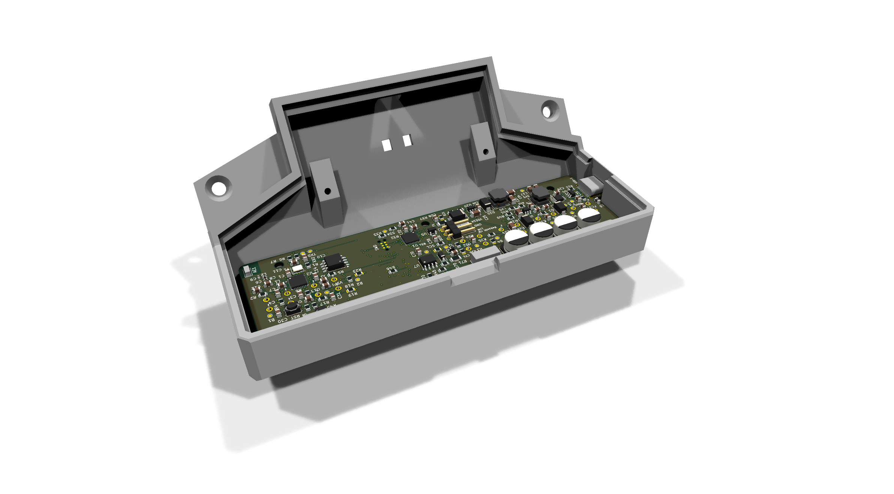
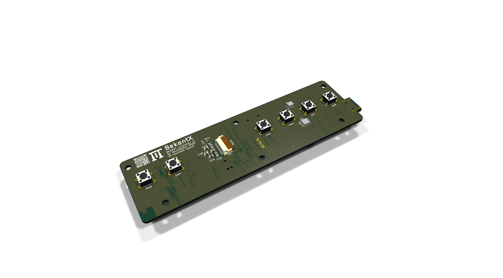
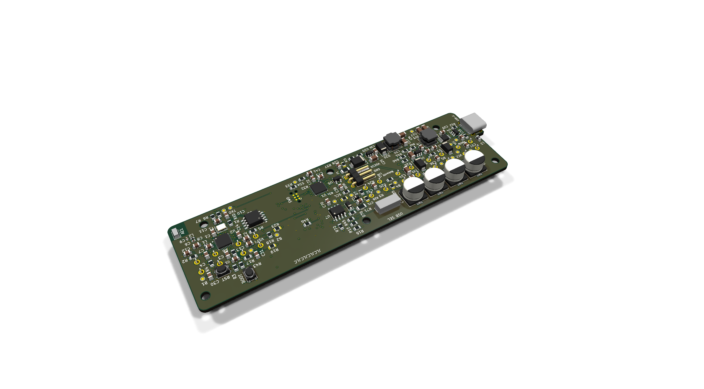
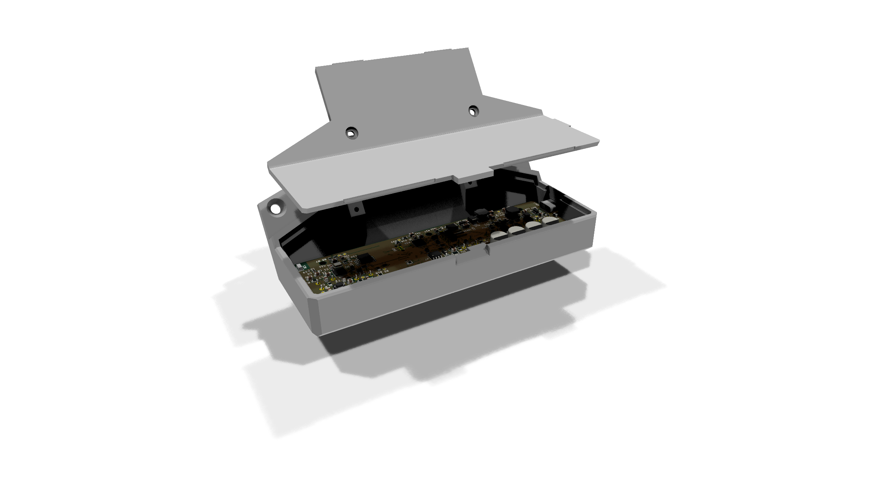
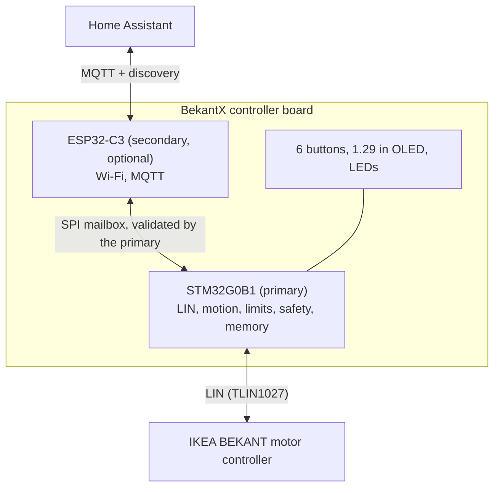

<div align="center">

# BekantX

**An open replacement controller for the IKEA BEKANT standing desk, with its schematic, PCB layout and enclosure designed by an AI (Claude) under human review.**

[](LICENSE)
[](LICENSES/GPL-3.0-or-later.txt)
[](LICENSES/CC-BY-SA-4.0.txt)
[](https://www.kicad.org/)
[](https://github.com/espressif/esp-idf)
[](#status)



</div>

---

## What this is

BekantX replaces the button box of an IKEA BEKANT sit/stand desk with a custom controller. It provides memory
positions, limits, obstruction detection, a small OLED display, and an optional Wi-Fi link to Home Assistant
that works locally, without a cloud.

The project is also an **experiment**: how far can an AI model take real hardware design? The schematic changes,
the component placement, the 6-layer PCB layout, the parametric 3D-printed enclosure and the fit checks between
board and case were done by [Claude](https://www.anthropic.com/claude) through
[Claude Code](https://claude.com/claude-code). It worked with scripts and the KiCad and build123d APIs, not
through a GUI. A human set the requirements, made the decisions, reviewed every pull request, and printed and
tested the parts.

> [!NOTE]
> Part of the point is to be honest about the results. Every pull request lists what was verified (ERC, DRC,
> fit check, renders) and what was not. Open findings are tracked in the project notes in
> [`Vault/`](Vault/00%20Index.md).

## Highlights

- **Dual controller, safety first.** An STM32G0B1 owns the LIN bus to the desk, motion and every safety rule.
  An optional ESP32-C3 adds Wi-Fi, MQTT and Home Assistant discovery. The desk keeps working without the ESP,
  and the ESP can never move the desk without the STM32's validation.
- **One 6-layer board.** 129 × 38 mm, one track direction per layer: F.Cu vertical, In1 (+3V3 and VCC area),
  In2 horizontal, In3 vertical, In4 (solid GND), B.Cu horizontal. Routed with Freerouting, tuned by parameter
  sweeps, then finished by scripts: tracks through pad and via centres, only 45° corners, via teardrops, short
  supply stubs to the planes and large GND pours on the outer layers that are cut as little as possible.
- **Parametric enclosure.** Built in [build123d](https://github.com/gumyr/build123d), with every dimension a
  named parameter. The board outline, mounting holes, buttons and display position are exported from the
  enclosure model to the PCB (`CAD/board_interface.json`), and the board STEP is checked against the case for
  collisions.
- **Local smart home.** ESP-IDF C++ firmware with a Wi-Fi captive portal, MQTT, Home Assistant auto discovery
  and a status LED.
- **Reproducible.** Every layout step is a script in [`tools/pcb/`](tools/pcb). The design rules, decisions
  and open points are documented in the vault.

## Gallery

<table>
  <tr>
    <td align="center"><br><sub>Front side: six buttons, OLED connector, status LEDs, title block with QR code</sub></td>
    <td align="center"><br><sub>Back side: input protection and regulators, STM32G0B1, ESP32-C3 with chip antenna, USB-C</sub></td>
  </tr>
  <tr>
    <td align="center"><br><sub>Board, case and lid (render of the CAD models)</sub></td>
    <td align="center"><br><sub>Enclosure r3, printed in PLA (without keypad and board)</sub></td>
  </tr>
</table>

## Architecture



| Document | Content |
| --- | --- |
| [Requirements](Docs/description.md) | Goals, functional and safety requirements (SR-001 … SR-007) |
| [Architecture](Docs/architecture.md) | Controller split, responsibilities, state ownership |
| [Inter-controller protocol](Docs/inter-controller-protocol.md) | SPI frames between ESP32-C3 and STM32 |
| [BEKANT LIN protocol](Docs/bekant-lin-protocol.md) | What is known about the desk's LIN bus |
| [Assembly guide](Docs/Montageanleitung.md) | Printing, keypad, display, board, lid and mounting under the desktop (German); English PDF: [BekantX_Assembly_Guide.pdf](Docs/BekantX_Assembly_Guide.pdf) |
| [Bill of materials](Docs/BekantX_Bill_of_Materials.pdf) | 127 board placements (6 not populated) and the parts outside the PCB |
| [Renderings and photos](Docs/bilder/README.md) | Board and enclosure renders, photos of the printed case |
| [`Docs/datasheets/`](Docs/datasheets) | Third-party datasheets (display, ESP32, LMR51610), see [LICENSES](LICENSES/README.md) |

## Hardware at a glance

| Block | Parts |
| --- | --- |
| Primary MCU | STM32G0B1KB (QFN-32) |
| Secondary MCU | ESP32-C3 + W25Q32 flash, Johanson 2450AT18A100 chip antenna |
| Desk interface | 3-pin connector (supply, GND, LIN), TLIN1027 LIN transceiver, fuse, TVS SMBJ33CA, reverse-polarity protection |
| Power | LV2862 buck to 12 V (LIN VSUP), LMR51610 buck to 3.3 V, USB-C supply as an alternative |
| USB | USB-C with ESD protection (USBLC6), TS3USB30 switch: USB goes to the ESP32-C3 or to the STM32 |
| User interface | 6 × 6 mm tactile buttons, 1.29" OLED (CH1115) on a 16-pin FPC, SK6812 status LED, RGB LED |
| Board | 6 layers, 1.6 mm (stackup ASSUMPTION, JLC06161H-2116 pattern, not yet checked with the fab), 0.15 / 0.15 mm rules, ENIG |

> [!WARNING]
> The desk's electrical interface (supply voltage, LIN levels, connector pinout) has **not been measured** on a
> real desk yet. Those parts of the design are marked `ASSUMPTION` and listed in
> [`Vault/Offene Punkte.md`](Vault/Offene%20Punkte.md). Do not connect this board to your desk before checking
> them.

## How the AI-driven design works

All the work happens in [Claude Code](https://claude.com/claude-code) against this repository:

- **Project memory**: [`CLAUDE.md`](CLAUDE.md) holds the rules (guardrails for electronics, mechanics, firmware
  and git). The Obsidian vault [`Vault/`](Vault/00%20Index.md) holds the *why*: decisions, status and open
  points. The vault is written in German.
- **Roles as skills**: architecture, schematic design, component selection, PCB design, mechanical CAD,
  firmware, tests, CI and fab export. Each is a skill in [`.claude/skills/`](.claude/skills).
- **Independent review**: read-only reviewer subagents (schematic, PCB, CAD, code) check every change without
  the author's bias. Their findings go into the pull request unchanged.
- **Hooks**: [`.claude/hooks/`](.claude/hooks) enforce the git rules and run ERC/DRC automatically after every
  edit to a KiCad file.
- **Layout pipeline** (KiCad 10 Python API, `pcbnew`):
  1. placement from the enclosure interface;
  2. Freerouting in two stages (power first, then signals), with parameter sweeps;
  3. a custom A* touch-up router;
  4. plane rework, pad-entry straightening and corner chamfering;
  5. supply stubs to the planes, GND pour stitching, the board outline, and the silkscreen with labels, logo and QR code;
  6. the move to 6 layers with one track direction per layer (fan-out, direction-constrained routing runs), 45°
     chamfers instead of 90° corners, via teardrops.

  Details: [`Vault/Toolchain.md`](Vault/Toolchain.md).
- **Mechanics**: [`CAD/src/bekantx_enclosure.py`](CAD/src/bekantx_enclosure.py) builds the case, lid and keypad,
  and exports STEP + STL. [`CAD/src/check_board_fit.py`](CAD/src/check_board_fit.py) checks the real board STEP
  against the case.

## Repository layout

```
CAD/              enclosure exports (STEP/STL), board STEP, board interface; sources in CAD/src
Docs/             requirements, architecture, protocols, assembly guide, bill of materials (PDF)
  bilder/         renderings and photos
  datasheets/     third-party datasheets
Firmware/
  ESP32C3/        ESP-IDF C++ firmware of the secondary controller
  ST/             STM32CubeMX project of the primary controller (no code yet)
Pcb_Controller/   KiCad 10 project: hierarchical schematic and 6-layer board
tools/pcb/        layout pipeline (placement, routing, touch-up, post-processing)
tools/sch/        scripted schematic edits
tools/docs/       PDF builders (bill of materials, assembly guide)
Vault/            project memory (Obsidian, German)
.claude/          skills, reviewer subagents and hooks for Claude Code
```

## Build and check

```bash
# KiCad 10: electrical and design rule checks, 3D export (Windows paths, see Vault/Toolchain.md)
kicad-cli sch erc --format json -o erc.json Pcb_Controller/BekantX.kicad_sch
kicad-cli pcb drc --schematic-parity --format json -o drc.json Pcb_Controller/BekantX.kicad_pcb
kicad-cli pcb export step --subst-models --user-origin 100x80mm -o CAD/BekantX_PCB.step Pcb_Controller/BekantX.kicad_pcb

# Enclosure (Python 3.13 with build123d) and fit check against the board
python CAD/src/bekantx_enclosure.py
python CAD/src/check_board_fit.py

# PDFs: bill of materials (KiCad's Python) and assembly guide (Python with Pillow); both print with Microsoft Edge
"C:/Program Files/KiCad/10.0/bin/python.exe" tools/docs/bom_pdf.py
python tools/docs/makerworld_pdf.py

# ESP32-C3 firmware (ESP-IDF environment)
cd Firmware/ESP32C3/BekantX && idf.py set-target esp32c3 && idf.py build
```

## Status

| Area | State |
| --- | --- |
| Requirements and architecture | done, see `Docs/` |
| Schematic | done; ERC 0 errors (28 old warnings) |
| PCB layout (6 layers) | done and reviewed in KiCad; DRC 0 errors, 0 unconnected, schematic parity OK; not yet manufactured |
| Enclosure r3 | printed (PLA); case and lid fit; fit check against the 6-layer board passes in CAD; final print in PETG pending |
| Bill of materials | 127 placements, 121 to populate; no supplier part numbers yet, J10 and Y1 without MPN |
| Assembly guide | written (German and English PDF); not yet tried with a populated board |
| ESP32-C3 firmware | Wi-Fi provisioning, MQTT, Home Assistant discovery, status LED; developed on an ESP32-S2-Saola board until the controller board exists |
| STM32 firmware | not started (CubeMX pin configuration only) |
| Desk interface | **unverified**: to be measured on a real BEKANT |

The next steps are measuring the desk interface, ordering the first boards, writing the STM32 firmware with the
LIN and motion logic, and the inter-controller SPI link. The full list is in
[`Vault/Offene Punkte.md`](Vault/Offene%20Punkte.md).

## Safety and disclaimer

A standing desk is a heavy, motorised machine. BekantX is a hobby project without any certification. Anything
you build from it is at your own risk. Collision detection is heuristic and is no substitute for paying
attention.
"IKEA" and "BEKANT" are trademarks of Inter IKEA Systems B.V. This project is not affiliated with or endorsed
by IKEA.

## License

| Part | License |
| --- | --- |
| Hardware (`Pcb_Controller/`, `CAD/`) | [CERN-OHL-S-2.0](LICENSE) |
| Software (`Firmware/`, `tools/`, `CAD/src/`, `.claude/`) | [GPL-3.0-or-later](LICENSES/GPL-3.0-or-later.txt) |
| Documentation (`Docs/`, `Vault/`, this README) | [CC-BY-SA-4.0](LICENSES/CC-BY-SA-4.0.txt) |

Details and exceptions (third-party datasheets) are in [`LICENSES/README.md`](LICENSES/README.md).

## Acknowledgements

- [LYFT mk2](https://github.com/mgkoenig/lyft_mk2) by mgkoenig: the idea of a LIN controller plus an ESP for
  the BEKANT.
- [KiCad](https://www.kicad.org/), [Freerouting](https://github.com/freerouting/freerouting),
  [build123d](https://github.com/gumyr/build123d) and [ESP-IDF](https://github.com/espressif/esp-idf).
- Designed with [Claude Code](https://claude.com/claude-code) by Anthropic, reviewed and built by
  [MootSeeker](https://github.com/MootSeeker).
